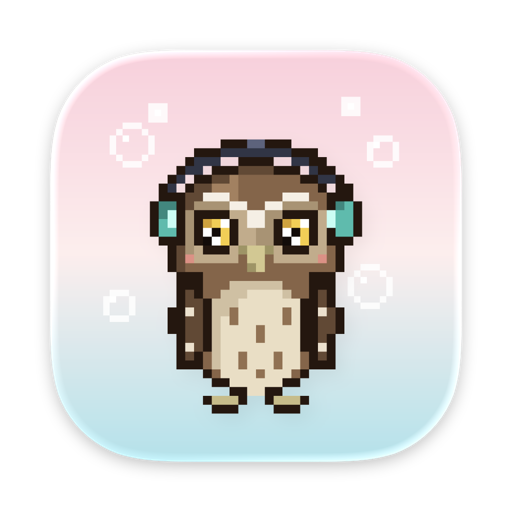
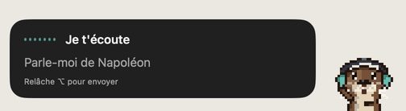
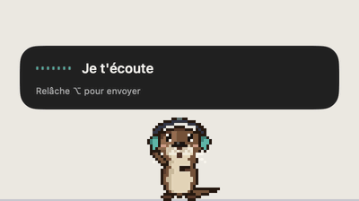
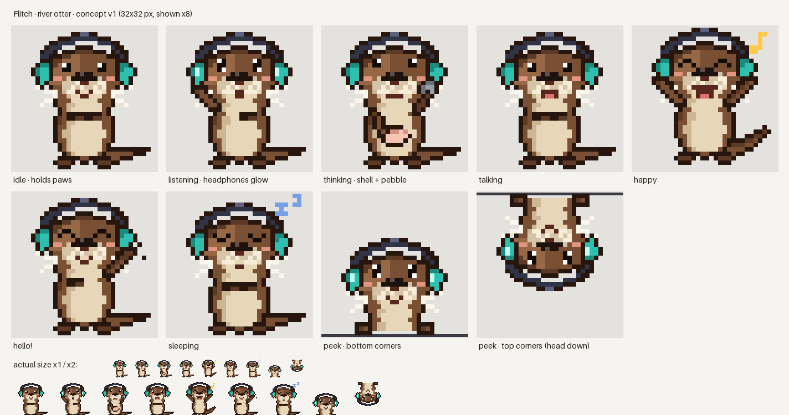
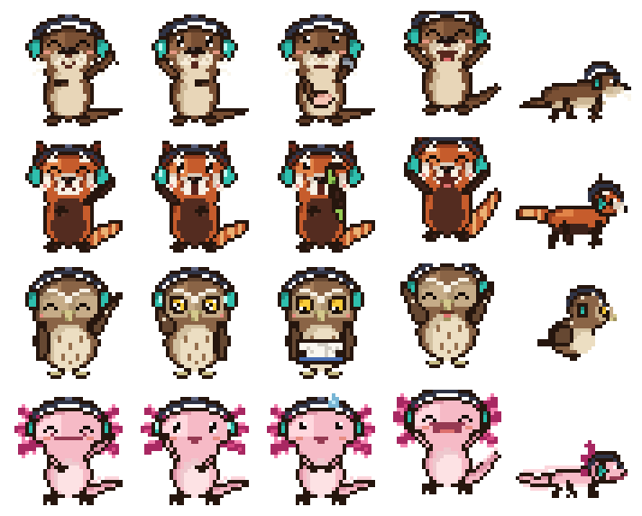

<p align="center">
  
</p>

<h1 align="center">Flitch</h1>

<p align="center">
  <b>Un assistant vocal pour macOS, incarné par un animal en pixel art : une loutre, un panda roux, une chouette ou un axolotl.</b><br>
  Maintiens une touche, pose ta question, elle te répond à voix haute.
</p>

<p align="center">
  <a href="README.md">English</a> ·
  <a href="https://pardival.github.io/flitch/">Site web</a> ·
  <a href="docs/architecture.md">Architecture</a> ·
  <a href="https://github.com/Pardival/flitch/milestones">Feuille de route</a> ·
  <a href="CONTRIBUTING.md">Contribuer</a>
</p>

---

> **État : en cours de développement**, en route vers la v0.1. Installation : [guide](docs/install.fr.md) (DMG ou `brew install pardival/tap/flitch` dès la première version publiée).

<p align="center"> </p>

## Flitch, c'est quoi ?

La plupart des assistants IA sont une fenêtre de chat. Flitch est un **petit personnage qui vit sur ton écran** :

1. **Maintiens ⌥ droite.** La loutre apparaît dans un coin de l'écran : tête en bas dans un coin du haut, ou en surgissant du bord dans un coin du bas.
2. **Parle.** Elle t'écoute avec son casque. Ta voix est transcrite sur ton Mac.
3. **Relâche.** Elle réfléchit en cassant un coquillage avec son galet, puis **te répond à voix haute** avec une bulle.
4. Elle reste **15 secondes**, puis s'en va. Clique sur la bulle pour garder la réponse complète.

Demande-lui par exemple « Parle-moi de Napoléon » ou « Quelle est l'actualité aujourd'hui ? ».

<p align="center">
  
</p>

## Les personnages

Choisis ton compagnon dans **Réglages › Personnalité**. Chacun a son allure, ses gestes, sa voix animale et sa personnalité, et tous portent le casque turquoise de Flitch.

<p align="center">
  
</p>

| | Personnage | Caractère | Quand il réfléchit | Sur le Dock |
|---|---|---|---|---|
| 🦦 | **Flitch**, la loutre | Gentille et curieuse | Casse un coquillage avec son galet | Jongle avec des galets, dort sur le dos |
| 🐼 | **Pip**, le panda roux | Joueur, un brin farceur | Grignote une pousse de bambou | Jongle avec des pommes, dort enroulé dans sa queue |
| 🦉 | **Hulo**, la chouette chevêche | Sage et calme | Lit un petit livre | Sautille, se lisse les plumes, somnole toute gonflée |
| 🩷 | **Axo**, l'axolotl | Doux et rêveur | Fait des bulles | Jongle avec des bulles, rampe le long du Dock |

## Fonctionnalités

- **Ton IA, en un clic** :
  - *Continuer avec ChatGPT*, qui utilise ton abonnement Plus ou Pro ;
  - *Se connecter avec OpenRouter*, un seul compte pour Claude, Gemini, Grok, Mistral, DeepSeek, Qwen, Kimi… ;
  - des clés API ;
  - un **modèle local** (Ollama, LM Studio).
- **Le choix du modèle**, ou un choix automatique d'un modèle récent selon la vitesse voulue. Chaque modèle affiche un niveau de prix, de « très bon marché » à « cher » : le vrai prix pour OpenRouter, une estimation d'après le nom pour OpenAI.
- **Des voix à tester avant de choisir** :
  - un *langage animal* gratuit ;
  - les voix Apple ;
  - des voix premium : ElevenLabs, OpenAI, Cartesia, Mistral, Gemini.
- **Recherche web** grâce à la recherche intégrée de ton fournisseur.
- **Une mémoire que tu contrôles** :
  - une fiche « À propos de moi » ;
  - ce qu'elle apprend en discutant, avec ton accord à chaque fois.

  Tout reste sur ton Mac.
- **Quatre personnages** (loutre, panda roux, chouette, axolotl) et **cinq tons** : enthousiaste, calme, professionnel, blagueur, taquin.
- **Deux modes** : le **mode discret**, dans un coin de l'écran, ou le **mode Dock**, où elle se balade, danse et fait la sieste sur ton Dock.
- Anglais, français, espagnol.

## Confidentialité

- **Aucun serveur Flitch** : ton Mac parle directement au fournisseur que tu as choisi.
- Les clés et jetons sont rangés dans le **Trousseau de macOS**.
- Ta voix est transcrite sur l'appareil par défaut et **n'est jamais enregistrée**.
- L'historique et la mémoire sont un fichier local, que tu peux effacer quand tu veux.
- **Aucune télémétrie.**

## Prérequis

- macOS 26 ou plus récent

## Les dessins

Chaque personnage est dessiné **par du code**, d'après des photos du vrai animal. Tout le monde peut donc retoucher une pose ou les couleurs :

```bash
python3 -m pip install -r art/requirements.txt
python3 art/otter.py --pack   # la loutre
python3 art/red_panda.py      # Pip
python3 art/owl.py            # Hulo
python3 art/axolotl.py        # Axo
```

Chaque script écrit ses images dans `Characters/<id>/sprites` et une planche de contrôle dans `art/preview/<id>/`. Les outils de dessin communs sont dans `art/pixel.py`.

Un personnage est un **pack** : les images, un `pack.json` (animations, voix animale, comportement sur le Dock) et une personnalité en anglais, français et espagnol. Ajouter un dossier dans `Characters/` ajoute un personnage, sans écrire de code.

## Licence

- Code : [MIT](LICENSE)
- Dessins (sprites, personnages) : [CC BY 4.0](LICENSE-ART.md)
