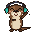
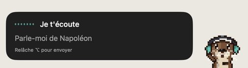
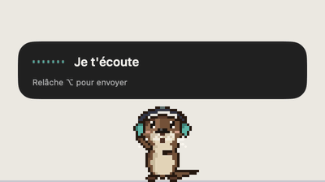
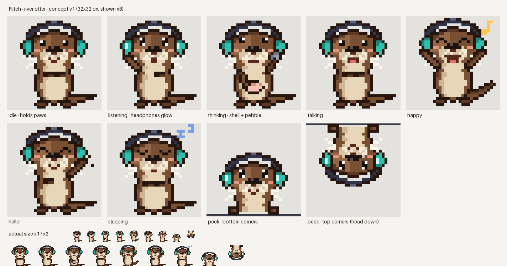

<p align="center">
  
</p>

<h1 align="center">Flitch</h1>

<p align="center">
  <b>A voice assistant for macOS, embodied by a pixel-art otter.</b><br>
  Hold a key, ask anything, and she answers out loud.
</p>

<p align="center">
  <a href="https://github.com/Pardival/flitch/actions/workflows/ci.yml"></a>
</p>

<p align="center">
  <a href="README.fr.md">Français</a> ·
  <a href="docs/architecture.md">Architecture</a> ·
  <a href="https://github.com/Pardival/flitch/milestones">Roadmap</a> ·
  <a href="CONTRIBUTING.md">Contributing</a>
</p>

---

> **Status: early development**, heading for v0.1. Install: [guide](docs/install.md) (DMG or `brew install pardival/tap/flitch` once the first release is out).

<p align="center"> </p>

## What is Flitch?

Most AI assistants are a chat window. Flitch is a **little character that lives on your screen**:

1. **Hold right ⌥.** The otter peeks into a corner of your screen. At the top she comes down head-first; at the bottom she pops up.
2. **Talk.** She listens with her headphones on. Speech is transcribed on your Mac.
3. **Release.** She thinks, cracking a shell with her pebble, then **answers out loud** with a speech bubble.
4. She stays **15 seconds**, then goes away. Click the bubble to keep the full answer.

Ask her things like *"Tell me about Napoleon"* or *"What's in the news today?"*.

<p align="center">
  
</p>

## Planned features (v0.1)

- **Bring your own AI, in one click.** Use *Continue with ChatGPT* (your Plus/Pro plan) or *Sign in with OpenRouter* (one account for Claude, Gemini, Grok, Mistral, DeepSeek, Qwen, Kimi…). You can also use API keys or a **local model** (Ollama, LM Studio).
- **Voices you can try before you pick:**
  - a free *animal voice* in otter chirps;
  - Apple voices;
  - premium voices from ElevenLabs, OpenAI, Cartesia, Mistral and Gemini.
- **Web search** through your provider's built-in search, for news and recent facts.
- **Memory you control:** an "About me" profile, plus things she learns. She asks before remembering anything, and everything stays on your Mac.
- **Personalities:** Enthusiastic, Calm, Professional, Funny, Teasing.
- **Discreet mode** (a corner of the screen) or **Dock mode** (she walks, dances and naps on your Dock).
- English, French and Spanish.

## Privacy

- **No Flitch server.** Requests go straight from your Mac to the provider you chose.
- API keys and tokens live in the **macOS Keychain**.
- Audio is transcribed on-device by default and **never stored**.
- History and memories are a local SQLite file you can wipe at any time.
- **No telemetry.**

## Requirements

- macOS 26 or later

## Building from source

The app is not buildable yet. Milestone **M0** sets up the project. Once it lands:

```bash
brew install xcodegen
xcodegen generate && open Flitch.xcodeproj
```

The core logic lives in `Packages/FlitchKit` and is tested with `swift test`.

## The art

The otter is drawn **in code**, so anyone can tweak a pose or the palette:

```bash
python3 -m pip install -r art/requirements.txt
python3 art/otter.py        # → art/preview/
```

Characters come as **packs** (sprites + `pack.json` + personality + voice). More animals are planned.

## License

- Code: [MIT](LICENSE)
- Art (sprites, character designs): [CC BY 4.0](LICENSE-ART.md)
