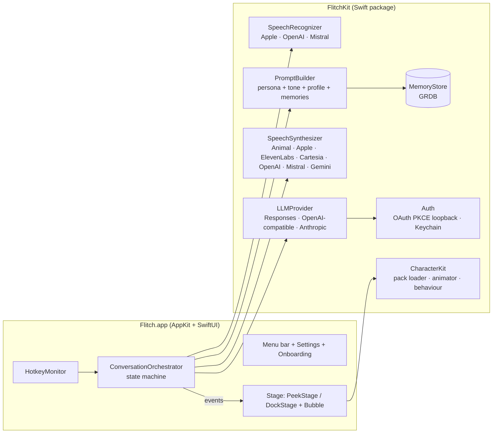
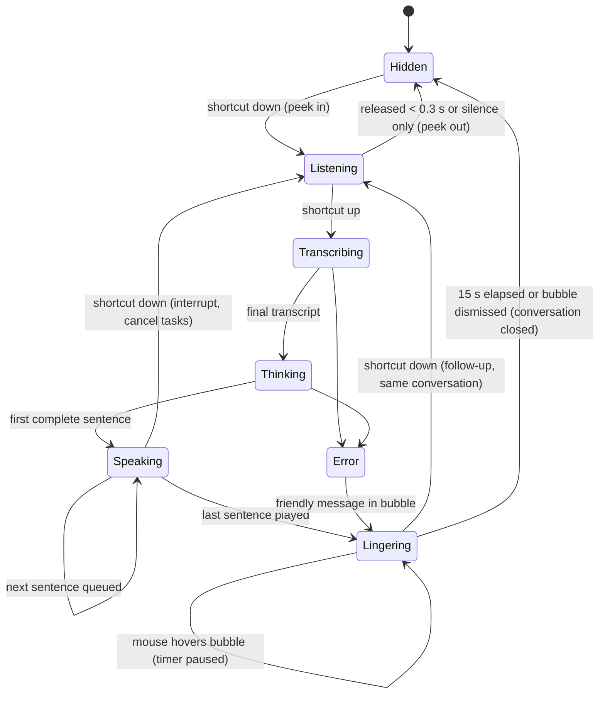

# Flitch architecture

> Flitch is an open-source macOS voice assistant embodied by a pixel-art animal: a brown river otter with headphones.
> You hold a shortcut, talk, release it, and the otter answers out loud with a dialogue bubble.

Status: **draft for validation**, November 2026. Inputs: [product decisions](#1-product-scope-v01) and [research](research/2026-11-providers-voices.md).

---

## 1. Product scope (v0.1)

| In | Later | Out for now |
|---|---|---|
| Discreet mode: the otter peeks from a configurable screen corner, on the screen with the mouse | Dock mode: walking otter (milestone M5) | Text input |
| Hold-to-talk: listen → release → think → spoken answer that reads everything | Wake word | Weather, Mac actions (calendar, apps…) |
| Bubble stays 15 s after the answer ends; hovering pauses it, clicking opens the full answer | MCP tools | Music detection |
| Pressing the shortcut while she talks interrupts; a follow-up within the window continues the conversation | More characters | Telemetry |
| Providers: Continue with ChatGPT, Sign in with OpenRouter, API keys (Anthropic, OpenAI, Gemini, xAI, DeepSeek, Mistral, Qwen, Kimi), local (Ollama, LM Studio) | | |
| Built-in web search from the provider | | |
| Voices: animal voice, Apple, ElevenLabs, Cartesia, OpenAI, Mistral, Gemini, with preview | | |
| Tone presets, "About me" profile, learned memories with confirmation, conversation history | | |
| EN / FR / ES, macOS 26+ | | |

## 2. Technology choices

| Choice | Decision | Why |
|---|---|---|
| Language / UI | **Swift 6.2** (strict concurrency). **AppKit** for the transparent overlay windows, **SwiftUI** for settings and onboarding. | Native look, crisp pixel rendering, full control over window levels. Matches the prototype. |
| Project | **XcodeGen** (`project.yml`) generates the `.xcodeproj`, plus **one Swift package `FlitchKit`** with several targets | No `.pbxproj` merge conflicts for contributors. Logic is testable with `swift test`, without Xcode. |
| Persistence | **SQLite through GRDB** (history, memories, full-text search). **Keychain** for secrets. `UserDefaults` for settings. | One local file, easy to wipe, search built in. Secrets never leave the Keychain. |
| Updates | **Sparkle 2** (EdDSA-signed appcast on GitHub Releases) | Works without an Apple Developer account. |
| Localization | String Catalogs (`.xcstrings`): EN, FR, ES | Native tooling. Easy for translators. |
| Dependencies | GRDB, Sparkle, KeyboardShortcuts (shortcut recorder). Later: MCP Swift SDK. | Small and permissive (MIT). |
| Sandbox | Not sandboxed. Hardened runtime, ad-hoc signed. | The overlay above the Dock, window-list inspection and the keyboard event tap don't fit the sandbox. We don't target the Mac App Store. |

## 3. Big picture



**Rule:** `FlitchKit` has **no AppKit dependency**, except in the `FlitchStage` target. The orchestrator sends **events** (`.listening`, `.partialTranscript`, `.thinking`, `.sentence(text)`, `.speakingLevel(Float)`, `.lingering`, `.dismissed`, `.error`). The stage turns them into animations. So the whole flow can be tested headless.

## 4. Repository layout

```
flitch/
├── project.yml                  # XcodeGen → Flitch.xcodeproj (git-ignored)
├── App/                         # app target: entry point, menu bar, settings & onboarding (SwiftUI), Info.plist, entitlements
├── Packages/FlitchKit/
│   ├── Package.swift
│   ├── Sources/
│   │   ├── FlitchCore/          # models, protocols, ConversationOrchestrator, PromptBuilder, SentenceChunker
│   │   ├── FlitchProviders/     # LLM adapters, provider presets, web-search mapping, Auth (PKCE, loopback server, Keychain)
│   │   ├── FlitchVoice/         # audio capture, speech-to-text engines, voice engines, playback + level meter, AnimalVoice synth
│   │   ├── FlitchMemory/        # GRDB schema, history, profile, memories
│   │   ├── FlitchCharacter/     # character pack format, animation player, behaviour engine (pure logic)
│   │   └── FlitchStage/         # AppKit: overlay panels, PeekStage, DockStage, DockTracker, BubbleView, screen picking
│   └── Tests/…                  # one test target per module + fixtures
├── Characters/otter/            # the default character pack (see §8)
├── art/                         # sprite sources and generator scripts, previews
├── docs/                        # architecture, ADRs, research, mockups, install guide
├── scripts/                     # bootstrap, build-dmg, release
└── .github/                     # CI, release workflow, issue/PR templates
```

## 5. Conversation flow



- **Latency target:** under 1.5 s from release to the first sound (cloud voice), and under 0.5 s with the animal or Apple voice.
- **Pipeline:**
  1. Apple speech-to-text runs **while you talk** (live partial results), so the final text is ready almost at release.
  2. The LLM **streams** its answer.
  3. `SentenceChunker` cuts the stream into sentences, each sent to the voice engine as soon as it is complete.
  4. The audio queue plays sentence N while sentence N+1 is being synthesized.
  5. The bubble's typewriter follows the audio.
- **Cancellation:** structured concurrency. One `Task` per turn; cancelling it cancels speech-to-text, the LLM stream, voice synthesis and playback.
- **Conversation window:** turns stay in short-term context while the otter is visible. When it hides, the conversation is closed and saved to history.

## 6. Providers

### 6.1 Abstractions

```swift
public protocol LLMProvider: Sendable {
    var id: ProviderID { get }
    var capabilities: ProviderCapabilities { get }     // .webSearch, .tools, .reasoningEffort, …
    func models() async throws -> [ModelInfo]
    func stream(_ request: LLMRequest) -> AsyncThrowingStream<LLMEvent, Error>  // .textDelta, .toolCall, .citation, .done(usage)
}
```

Three adapters cover every provider:

| Adapter | Used for | Web search mapping |
|---|---|---|
| `OpenAIResponsesAdapter` | Continue with ChatGPT, OpenAI API key | `web_search` tool (API key only; not assumed to work on ChatGPT plan tokens) |
| `OpenAICompatibleAdapter` + **presets** (base URL, auth style, model list, capability flags) | OpenRouter, xAI, DeepSeek, Mistral, Qwen, Kimi, Gemini (compatible endpoint), Ollama, LM Studio | `openrouter:web_search` for OpenRouter; provider flags for the others, or none |
| `AnthropicMessagesAdapter` | Claude API key | `web_search` server tool |

- **Model choice:** each preset maps **Fast / Balanced / Precise** to a recommended model and to reasoning effort where supported. The user can override the model ID.
- **Presets** live in `providers.json`, bundled with the app. Adding a provider means adding a JSON entry, not code.

### 6.2 Authentication

- **OAuth PKCE with a loopback listener**, `OAuthLoopbackServer` (a tiny `127.0.0.1` HTTP server built on Network.framework), shared by:
  - ChatGPT: `auth.openai.com` authorization, dynamic client registration, rotating refresh tokens;
  - OpenRouter: the `/auth` page, exchanged for a user-owned key.
- **Secrets** (API keys, access and refresh tokens) live only in the Keychain (`kSecClassGenericPassword`, service `app.flitch.<provider>`). They are never logged. Error messages are scrubbed.
- `CredentialStore` exposes `credential(for:)` and refreshes tokens transparently, with a single refresh in flight per provider.

## 7. Voice

| Protocol | Engines |
|---|---|
| `SpeechRecognizer` (streaming partial and final text) | `AppleSpeechRecognizer` (SpeechAnalyzer + SpeechTranscriber, assets installed on first run), `OpenAITranscriber`, `MistralTranscriber` |
| `SpeechSynthesizer` (`synthesize(sentence, voice, locale) -> AudioChunk stream`) | `AnimalVoice`, `AppleVoice`, `ElevenLabsVoice`, `CartesiaVoice`, `OpenAIVoice`, `MistralVoice`, `GeminiVoice` |

- **AnimalVoice** is procedural synthesis in `AVAudioSourceNode`.
  - Each syllable becomes a short pitched blip shaped by the character's voice profile (base pitch, timbre, speed, randomness) from the pack.
  - It is deterministic per word, so the same word always "sounds" the same. It's free, instant, offline and works in any language.
- **Audio capture:** `AVAudioEngine` input tap, kept **in memory only**. No recording is written to disk.
- **Playback:** `AVAudioPlayerNode` queue with an RMS level meter. The level drives the mouth animation.
- **Voice preview** in settings: a sample sentence per locale, cached on disk per engine and voice.

## 8. Character packs

A pack is a folder (later a zipped `.flitchpack`) that needs **no code**:

```
Characters/otter/
├── pack.json         # id, name, version, author, license, pixel size, anchors, animations, behaviour tuning, voice profile
├── persona.en.md     # personality prompt per locale (persona.fr.md, persona.es.md)
├── sprites/*.png     # horizontal strips, one per animation (exported)
└── previews/         # gifs for the README / settings
```

`pack.json` (excerpt):

```json
{
  "id": "otter", "name": "Flitch the otter", "version": "1.0.0", "license": "CC-BY-4.0",
  "frame": { "width": 32, "height": 32 }, "anchors": { "foot": [16, 30], "bubble": [24, 6] },
  "animations": {
    "peek_in":   { "file": "peek_in.png",  "frames": 6, "fps": 12, "loop": false },
    "listen":    { "file": "listen.png",   "frames": 4, "fps": 6,  "loop": true },
    "think":     { "file": "think.png",    "frames": 8, "fps": 10, "loop": true, "events": { "3": "tap" } },
    "talk":      { "file": "talk.png",     "frames": 4, "fps": 0,  "driver": "audioLevel" }
  },
  "behaviour": { "idle": [["juggle", 0.5], ["groom", 0.3], ["dance", 0.2]], "sleepAfter": 180 },
  "voice": { "animal": { "pitch": 520, "timbre": "squeak", "speed": 1.1 } }
}
```

- **Behaviour engine** (`FlitchCharacter`): a pure state machine. It takes `tick(dt)`, `event` and `random` as input and outputs an animation and a movement intent, so it is unit-testable with a seeded random generator. The stage renders whatever it outputs.
- **Art pipeline:** sprites are made in code (Python + Pillow, as in the prototype) and exported to PNG strips. **Aseprite** is the target format for contributors once a working copy is available. Exported PNGs are committed, so neither Aseprite nor Python is needed to build.

## 9. Stages (overlay)

- **PeekStage** (default):
  - A borderless, non-activating `NSPanel` at `.statusBar` level, joining all Spaces.
  - On the screen that holds the mouse, at the chosen corner. The top-left corner sits under the menu bar, avoiding the notch.
  - Bottom corners: the otter rises half-body from the bottom edge, paws on the edge (`peek_in`). **Top corners: she comes down head-first from the top edge** (same frames, flipped vertically), just under the menu bar. The bubble opens towards the center of the screen.
  - The panel ignores mouse events except where the alpha mask is opaque (bubble and otter).
- **DockStage** (M5): the prototype's `DockTracker` (Dock geometry, autohide, fullscreen detection) and walking behaviour, ported.
- **BubbleView:** modern macOS 26 look — frosted glass (`NSVisualEffectView` / Liquid Glass), large radius, system font; pixel art is reserved for the character. Text appears in sync with the voice. Hovering pauses the 15 s timer; clicking opens the **Answer card** (full text, copy, sources, open in history).

## 10. Hotkey

- **Default: hold right ⌥.** This needs a `CGEventTap` on modifier changes, which requires the **Input Monitoring** permission, asked once during onboarding with an explanation screen.
- **Fallback:** any key combination, recorded with KeyboardShortcuts. It uses Carbon hot keys, which report both press and release and need **no permission**. If the user refuses Input Monitoring, onboarding switches to `⌃⌥Space`.
- A press shorter than 0.3 s doesn't listen (it avoids accidental taps).

## 11. Prompt, memory, history

- **PromptBuilder** assembles the system prompt from:
  - character persona (pack);
  - tone preset (Enthusiastic, Calm, Professional, Funny, Teasing);
  - spoken-style rules (no markdown or emoji, numbers as spoken, answer in the user's language);
  - "About me" profile;
  - top-k relevant memories (full-text search on the transcript, plus pinned ones);
  - date, locale and time zone.
  It is snapshot-tested.
- **Learned memories:** the model gets a `remember(fact)` tool. A call becomes a **pending memory** shown as a chip in the bubble ("Remember that you support Barça? ✓ ✗"). Only confirmed facts are stored.
- **Schema (GRDB):** `conversation(id, startedAt, providerId, model)`, `message(id, conversationId, role, text, createdAt)`, `memory(id, text, source, status[pending|active], createdAt, pinned)`, `profile(key, value)`, plus FTS5 indexes on messages and memories.
- **Privacy:**
  - everything stays local in `~/Library/Application Support/Flitch/flitch.sqlite`;
  - settings offer "Delete history" and "Delete all memories";
  - the history retention period is configurable.
- **Tools / MCP-ready:** `remember` and web search go through a `Tool` protocol (`name`, `JSON schema`, `invoke`). An `MCPToolSource` can later expose MCP server tools through the same protocol.

## 12. Settings and onboarding

**Onboarding**, about 6 screens:
1. Hello from the otter.
2. Connect a brain: Continue with ChatGPT / Sign in with OpenRouter / I have an API key / Local.
3. Microphone permission.
4. Shortcut and Input Monitoring.
5. Choose a voice, with preview.
6. Try it: "Hold ⌥ and ask me anything!"

**Settings tabs:**
- **General:** mode, corner, shortcut, language, launch at login.
- **Brain:** provider, account, model speed, web search on/off.
- **Voice:** engine, voice, preview, speed.
- **Personality:** tone preset.
- **Memory:** About me, memories list, history.
- **Characters**, **About**.

## 13. Quality

- **Unit tests** (Swift Testing), run with `swift test` in `Packages/FlitchKit`:
  - orchestrator state machine, driven by fake engines and a virtual clock;
  - `SentenceChunker`, `PromptBuilder` (snapshots), behaviour engine (seeded random);
  - provider request encoding and stream decoding, against recorded JSON and SSE fixtures through a `URLProtocol` stub;
  - PKCE (verifier/challenge vectors), token refresh rotation, memory store (in-memory SQLite).
- **Sprite checks:** a test validates every pack, so `pack.json` must match its PNGs (frame counts, sizes, anchors). Golden-image tests cover the animator.
- **CI (GitHub Actions, macOS runner with Xcode 26):** generate the project, build, run tests, run `swift-format` lint. Required on every PR.
- **Release workflow (on tag):** build, ad-hoc sign, DMG, Sparkle appcast, GitHub Release, Homebrew tap update.
- **Manual QA checklist** in `docs/qa.md` for what can't be automated: microphone, permissions, multi-screen, notch.

## 14. Milestones

| Milestone | Content | Result |
|---|---|---|
| **M0 Foundations** | repo, licences, CI, XcodeGen, package skeleton, contributing guide, issue templates | green CI on an empty app |
| **M1 Peek & talk** | PeekStage, hotkey, Apple speech-to-text, OpenRouter + API keys, streaming LLM, Animal + Apple voices, bubble, 15 s linger, otter v1 (peek, listen, think, talk, idle) | **first usable build** |
| **M2 Onboarding & settings** | Continue with ChatGPT, onboarding, settings tabs, tone presets, model speed, voice preview | usable by non-developers |
| **M3 Voices & search** | ElevenLabs, Cartesia, OpenAI, Mistral, Gemini voices; sentence pipeline tuning; web search per provider; answer card with sources | "What's the news today?" works |
| **M4 Memory** | About me, learned memories with confirmation, history browser | she knows who you are |
| **M5 Dock mode** | DockStage, walking and full behaviour set (juggle, groom, dance, sleep) | the living otter |
| **M6 Release 0.1** | DMG, tap, Sparkle, illustrated install guide, FR README, demo GIFs | public launch |

## 15. Open decisions (to validate)

1. **XcodeGen plus one multi-target package**, rather than a hand-maintained `.xcodeproj`.
2. **Default shortcut: hold right ⌥** (one Input Monitoring prompt), with a fallback to `⌃⌥Space` (no permission).
3. **GRDB/SQLite** for history and memory.
4. **Milestone order:** discreet mode first (M1), Dock mode last (M5).
5. **Repo:** `github.com/Pardival/flitch`, public from M0 (or private until M1).
