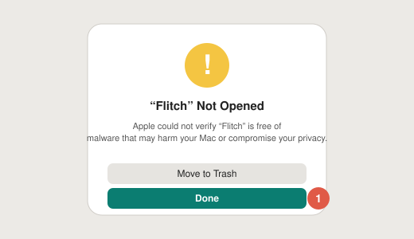
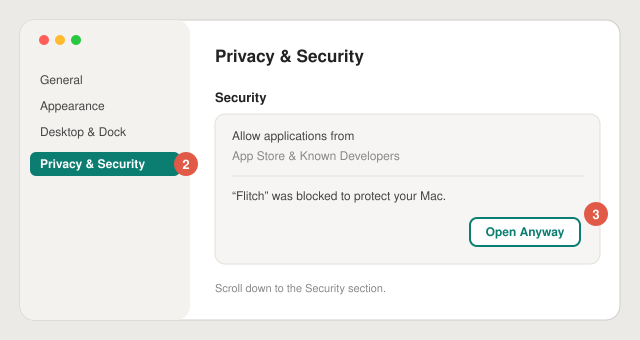
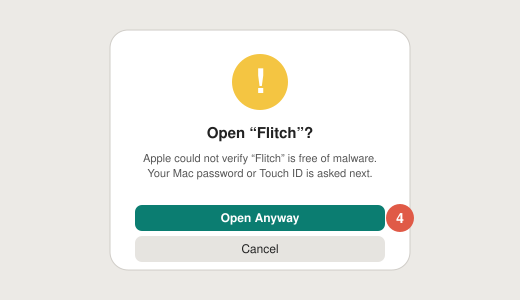

# Instalar Flitch

[English](install.md) · [Français](install.fr.md)

Flitch necesita **macOS 26 (Tahoe)** o posterior.

## 1. Descargar

- **DMG:** descarga `Flitch-x.y.z.dmg` desde la [última versión](https://github.com/Pardival/flitch/releases/latest),
  ábrelo y arrastra **Flitch** a **Aplicaciones**.
- **Homebrew:** `brew install pardival/tap/flitch`

## 2. Abrirlo la primera vez

Flitch es libre y gratuito, así que no está notarizado por Apple (cuesta 99 $ al año). macOS lo bloquea
la primera vez. Solo hay que permitirlo una vez:

1. Abre Flitch desde Aplicaciones. macOS dice *No se ha abierto «Flitch»*: haz clic en **OK**
   (no en *Trasladar a la papelera*).

   

2. Abre **Ajustes del Sistema** y ve a **Privacidad y seguridad**.
3. Baja hasta **Seguridad**: junto a *Se ha bloqueado «Flitch» para proteger tu Mac*, haz clic en
   **Abrir igualmente**.

   

4. Vuelve a hacer clic en **Abrir igualmente** y confirma con tu contraseña o Touch ID.

   

El truco antiguo (clic derecho → Abrir) ya no funciona desde macOS 15.

¿Quieres comprobar el archivo antes? Cada versión indica el SHA-256 del DMG: `shasum -a 256 Flitch-x.y.z.dmg`.

## 3. Configurarlo

Flitch abre una breve bienvenida:

1. **Conectar un cerebro:** *Continuar con ChatGPT* (plan Plus o Pro), *Iniciar sesión con OpenRouter*,
   una clave de API o un modelo local (Ollama, LM Studio).
2. **Micrófono:** Flitch solo escucha mientras mantienes la tecla. Tu voz se transcribe en tu Mac.
3. **Tecla para hablar:** mantén **⌥ derecha** (macOS pide *Monitorización de entrada*; Flitch no lee
   ninguna otra tecla), o usa **⌃⌥Espacio**.
4. **Voz:** la vocecita de la nutria, una voz de Apple o una voz premium con tu propia cuenta.

Después: mantén la tecla, haz tu pregunta y suelta.

## Actualizaciones

Flitch busca actualizaciones solo (Ajustes › General › Actualizaciones). Con Homebrew: `brew upgrade flitch`.

## Desinstalar

Sal de Flitch desde su icono en la barra de menús y muévelo a la papelera. Para borrar también tus datos,
elimina `~/Library/Application Support/Flitch` (historial y recuerdos) y ejecuta
`defaults delete app.flitch.Flitch`. Tus sesiones están en el Llavero, con el nombre *Flitch*.
