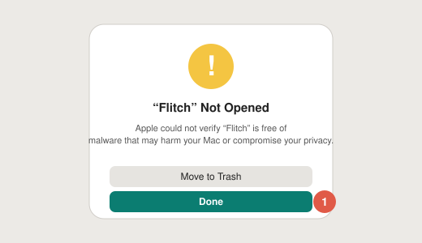
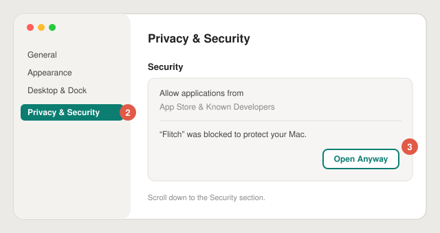
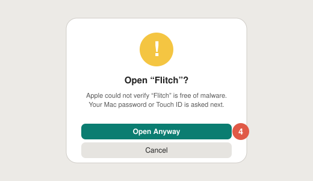

# Installer Flitch

[English](install.md) · [Español](install.es.md)

Flitch fonctionne sur **macOS 26 (Tahoe)** ou plus récent.

## 1. Télécharger

- **DMG :** télécharge `Flitch-x.y.z.dmg` depuis la [dernière version](https://github.com/Pardival/flitch/releases/latest),
  ouvre-le et glisse **Flitch** dans **Applications**.
- **Homebrew :** `brew install pardival/tap/flitch`

## 2. L'ouvrir la première fois

Flitch est libre et gratuit : il n'est donc pas notarié par Apple (cela coûte 99 $ par an). macOS le bloque
la première fois. Il suffit de l'autoriser une seule fois :

1. Ouvre Flitch depuis Applications. macOS affiche *« Flitch » n'a pas été ouvert* : clique sur **OK**
   (pas sur *Placer dans la corbeille*).

   

2. Ouvre **Réglages Système**, puis **Confidentialité et sécurité**.
3. Descends jusqu'à **Sécurité** : à côté de *« Flitch » a été bloqué afin de protéger votre Mac*, clique sur
   **Ouvrir quand même**.

   

4. Clique de nouveau sur **Ouvrir quand même** et confirme avec ton mot de passe ou Touch ID.

   

L'ancienne astuce (clic droit → Ouvrir) ne fonctionne plus depuis macOS 15.

Tu veux vérifier le fichier avant ? Chaque version indique l'empreinte SHA-256 du DMG :
`shasum -a 256 Flitch-x.y.z.dmg`.

## 3. Le configurer

Flitch ouvre un court accueil :

1. **Connecter un cerveau :** *Continuer avec ChatGPT* (abonnement Plus ou Pro), *Se connecter avec OpenRouter*,
   une clé API ou un modèle local (Ollama, LM Studio).
2. **Micro :** Flitch n'écoute que pendant que tu maintiens la touche. Ta voix est transcrite sur ton Mac.
3. **Touche pour parler :** maintiens **⌥ droite** (macOS demande la *Surveillance de l'entrée* ; Flitch ne lit
   aucune autre touche), ou utilise **⌃⌥Espace**.
4. **Voix :** la petite voix de la loutre, une voix Apple, ou une voix premium avec ton propre compte.

Ensuite : maintiens la touche, pose ta question, relâche.

## Mises à jour

Flitch vérifie lui-même les mises à jour (Réglages › Général › Mises à jour). Avec Homebrew : `brew upgrade flitch`.

## Désinstaller

Quitte Flitch depuis son icône dans la barre des menus, puis mets-le à la corbeille. Pour effacer aussi tes
données, supprime `~/Library/Application Support/Flitch` (historique et souvenirs) et lance
`defaults delete app.flitch.Flitch`. Tes connexions sont dans le Trousseau, sous *Flitch*.
