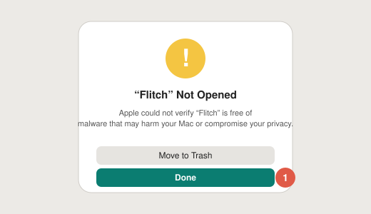
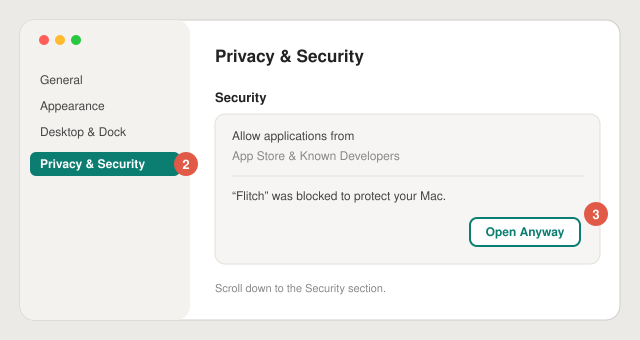
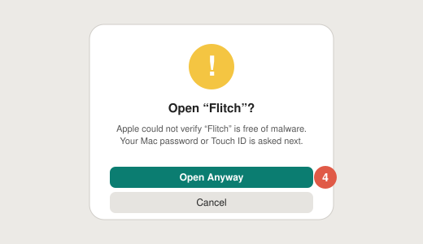

# Installing Flitch

[Français](install.fr.md) · [Español](install.es.md)

Flitch needs **macOS 26 (Tahoe)** or later.

## 1. Download

- **DMG:** download `Flitch-x.y.z.dmg` from the [latest release](https://github.com/Pardival/flitch/releases/latest),
  open it and drag **Flitch** onto **Applications**.
- **Homebrew:** `brew install pardival/tap/flitch`

## 2. Open it the first time

Flitch is open source and free, so it isn't notarized by Apple (that costs $99 a year). macOS blocks it
the first time. You only need to allow it once:

1. Open Flitch from Applications. macOS says *“Flitch” Not Opened*: click **Done** (not *Move to Trash*).

   

2. Open **System Settings** and go to **Privacy & Security**.
3. Scroll down to **Security**: next to *“Flitch” was blocked to protect your Mac*, click **Open Anyway**.

   

4. Click **Open Anyway** again and confirm with your password or Touch ID.

   

The old trick (right-click → Open) no longer works since macOS 15.

Want to check the file first? Each release lists the DMG's SHA-256: `shasum -a 256 Flitch-x.y.z.dmg`.

## 3. Set it up

Flitch opens a short welcome:

1. **Connect a brain:** *Continue with ChatGPT* (Plus or Pro plan), *Sign in with OpenRouter*, an API key,
   or a local model (Ollama, LM Studio).
2. **Microphone:** Flitch only listens while you hold the key. Your voice is transcribed on your Mac.
3. **Talk key:** hold **right ⌥** (macOS asks for *Input Monitoring*; Flitch never reads other keys),
   or use **⌃⌥Space** instead.
4. **Voice:** the otter's own little voice, an Apple voice, or a premium voice with your own account.

Then hold the key, ask your question, release.

## Updates

Flitch checks for updates itself (Settings › General › Updates). With Homebrew: `brew upgrade flitch`.

## Uninstall

Quit Flitch from its menu bar icon, then move it to the Trash. To remove your data too, delete
`~/Library/Application Support/Flitch` (history and memories) and run
`defaults delete app.flitch.Flitch`. Your sign-ins are in the Keychain under *Flitch*.
